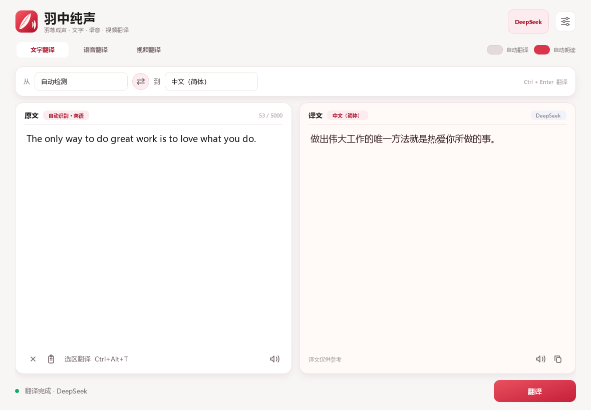
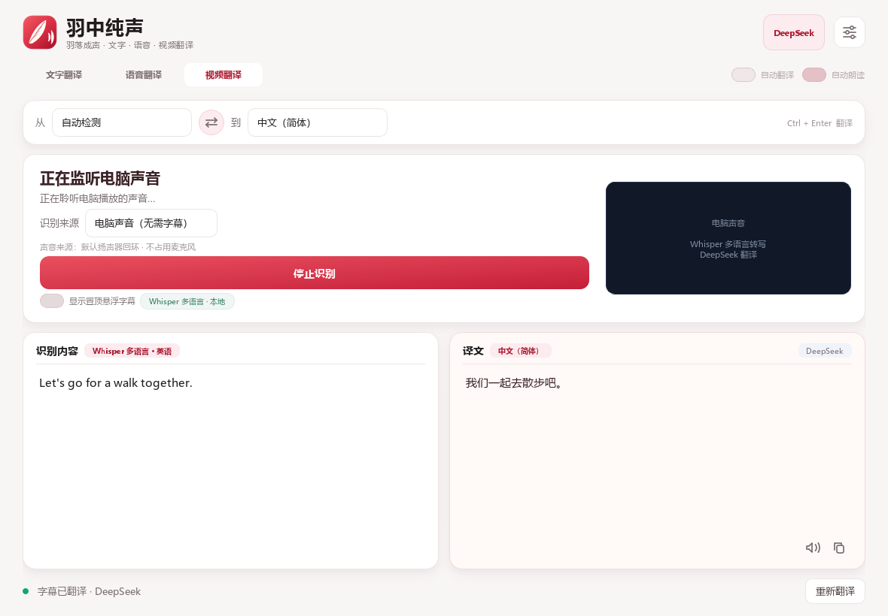
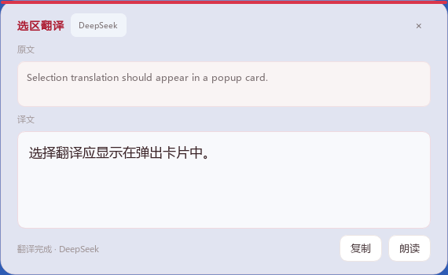

# 羽中纯声

一个给自己用的 Windows 桌面翻译器，重点服务两个场景：

- **看文本**：输入、粘贴，或者用全局快捷键框选屏幕上的任意文字，自动 OCR 并翻译。
- **看视频**：有字幕时可以框选字幕区域做 OCR；没有字幕时可以采集电脑播放的声音，在本机转写后自动翻译。

红色羽毛与声波构成的品牌标识。默认翻译引擎已经配置为 DeepSeek，目标语言默认是简体中文。

文字翻译支持 133 种目标语言，包含英语、日语、韩语、法语、德语、西班牙语、阿拉伯语、印地语、泰语、越南语、斯瓦希里语、泰米尔语等。常用语言置顶，其余语言可在下拉列表中滚动选择。



## 启动

双击工作目录里的 **`羽中纯声.lnk`**，或者双击 **`启动羽中纯声.cmd`**。

也可以直接运行：

```powershell
pythonw main.py
```

如果换了电脑或重装 Python，先安装依赖：

```powershell
python -m pip install -r requirements.txt
```

## 三种模式

### 文字翻译

- 输入、粘贴或从其他软件复制文字。
- 点“翻译”或按 `Ctrl + Enter`。
- 可开启“自动翻译”，输入停顿后自动查询。
- 源语言支持自动检测，目标语言支持完整语言目录。
- 结果可以复制，也可以使用 Windows 本地语音朗读。

### 语音翻译

- 点话筒开始说话，停顿后自动结束识别。
- 识别使用 Windows 本地语音引擎，翻译和朗读都在程序内完成。
- 当前电脑安装了中文普通话识别引擎。若要识别英语、日语等，需要在 Windows 的“设置 → 时间和语言 → 语言和区域 → 语音”中安装对应语音包。
- 朗读译文需要对应语言的 Windows 语音包。当前已检测到中文和英语朗读语音。

### 视频翻译

“视频翻译”里有两个识别来源：

#### 电脑声音（无字幕也能用）

1. 视频正常播放，声音从默认扬声器输出。
2. 在“视频翻译”中选择“电脑声音（无需字幕）”。
3. 点“开始识别”。
4. 程序通过 Windows 声音回环采集播放器声音，在本机用 Whisper 自动识别语言并转写成文字。
5. 转写结果自动交给 DeepSeek 翻译成中文，并可显示置顶悬浮字幕。

这个模式不占用麦克风，也不需要视频有字幕。源语言选择“自动检测”即可识别常见外语；音频只在本机处理，不会上传；发送给 DeepSeek 的是转写后的文字。

每个停顿分段都会重新检测语言，并携带最近三句识别文本作为上下文，帮助 DeepSeek 理解代词、术语和连续语义。

#### 画面字幕

如果视频本身有清晰字幕，也可以直接识别画面：

1. 播放视频，让字幕完整出现在画面里。
2. 识别来源选择“画面字幕”。
3. 点“框选字幕区域”，拖出一个刚好覆盖字幕条的矩形。
4. 程序会开始截取该区域，用本地 OCR 识别文字。
5. 字幕变化时自动调用 DeepSeek 翻译。
6. 勾选“显示置顶悬浮字幕”，译文字幕会显示在所有窗口上方，可以拖动位置。

使用建议：

- 框选区域尽量只包含字幕，少包含画面和台标，识别更快也更准。
- **不要让悬浮字幕挡住框选区域**，否则它可能把自己的译文再次识别进去。程序默认会把悬浮字幕放到字幕区域的反方向。
- 画面字幕 OCR 当前主要支持**中文和英文**混合字幕。
- 电脑声音转写使用本地多语言 Whisper，可识别英语、日语、韩语、法语、德语、西班牙语等常见语言；源语言建议保持“自动检测”。
- 系统声音模式大约会有一小段延迟，适合连续观看；暂停播放时不会继续产生字幕。



### 屏幕选区文字翻译

在任意软件中按 `Ctrl + Alt + T`，拖动框选屏幕上的文字。程序会在本机识别选区文字，并在选区附近弹出一个置顶结果卡片，显示原文和译文，不会把主窗口切换走。

弹窗支持复制译文、朗读和关闭，也可以拖动位置。文字页左下角同样有“选区翻译”按钮。全局快捷键即使程序最小化也能使用；如果被其他软件占用，程序会显示提示。

小范围选区只识别框选范围内的内容，不会向外补边；OCR 前会放大区块以提高清晰度。



## 快捷键

| 快捷键 | 功能 |
| --- | --- |
| `Ctrl + Enter` | 翻译当前模式的内容 |
| `Ctrl + Alt + T` | 全局快捷键，框选屏幕文字并翻译 |
| `Ctrl + Shift + C` | 复制当前译文 |
| `Ctrl + Shift + S` | 朗读当前译文 |
| `Ctrl + L` | 定位到输入区域 |
| `Esc` | 停止朗读或停止语音识别 |

## 翻译引擎与密钥

在右上角设置中可以切换：

- **DeepSeek**：默认引擎，适合中英互译。
- **Google 免费**：无需密钥，受网络环境影响。
- **MyMemory 免费**：无需密钥，适合 500 字符以内的短文本。
- **OpenAI 兼容接口**：可连接 OpenAI 或本地兼容服务。

DeepSeek 密钥使用 Windows DPAPI 加密后保存在：

```text
%APPDATA%\YiSheng\settings.json
```

为保留已有设置和密钥，内部数据目录沿用了旧标识 `YiSheng`，不影响应用名称和界面。

密钥不会写入源码。DPAPI 加密与当前 Windows 用户绑定；换电脑或换 Windows 用户后，需要在设置里重新填写密钥。

## 隐私

- 文字、语音转写结果和字幕文字会发送给所选的在线翻译引擎（默认 DeepSeek）。
- 语音识别、Whisper/Vosk 视频声音转写和 OCR 都在本机完成。
- 程序不在本地保存翻译历史；只保存设置、窗口位置和字幕区域坐标。

## 常见问题

**视频声音模式识别很慢**

系统声音会根据说话中的自然停顿和换气自动断句，检测到约 0.6 秒静音后立即转写，不再使用固定 5 秒切片。识别质量受背景音乐、说话速度和口音影响。

**提示 Whisper 多语言模型未安装**

运行：

```powershell
python scripts/install_whisper_model.py
```

模型默认安装到：

```text
%PROGRAMDATA%\YiSheng\models\whisper
```

如果 Whisper 不可用，程序会回退到英语 Vosk 模型。安装 Vosk：

运行：

```powershell
python scripts/install_vosk_model.py
```

模型会安装到：

```text
%PROGRAMDATA%\YiSheng\models\vosk
```

目录同样沿用内部标识 `YiSheng`。使用纯英文路径是因为 Vosk 无法正确读取包含中文的模型目录。

**字幕识别不正确**

尽量选择清晰、对比度高的硬字幕；不要把播放器控制栏一起框进去。OCR 目前主要支持中英文。

**翻译提示无法连接**

检查网络、代理和防火墙。也可以先在设置中切换到 Google 或 MyMemory 做连通性测试。

**没有声音朗读**

译文朗读调用 Windows 本地语音。检查系统输出设备，并在 Windows“语音”设置中安装目标语言语音包。

**语音模式提示没有识别引擎**

在 Windows“设置 → 时间和语言 → 语言和区域”中添加对应语言，并在该语言的“语音”可选功能中安装语音识别包。

## 开发与测试

```powershell
python -m pytest -q
```

主要文件：

- `main.py`：程序入口。
- `lingua/main_window.py`：主界面和交互。
- `lingua/translation.py`：DeepSeek、Google、MyMemory、OpenAI 兼容翻译。
- `lingua/ocr.py`：视频字幕与屏幕选区截图、本地 OCR。
- `lingua/audio_translate.py`：系统声音回环采集、Whisper 多语言转写与 Vosk 英语回退。
- `lingua/hotkeys.py`：全局快捷键 `Ctrl + Alt + T`。
- `lingua/overlay.py`：屏幕框选和置顶字幕。
- `lingua/speech.py`：Windows 语音识别与朗读。
- `scripts/`：Windows PowerShell 语音辅助脚本及 Whisper/Vosk 模型安装器。

